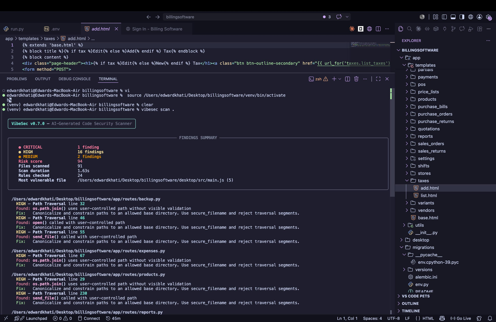
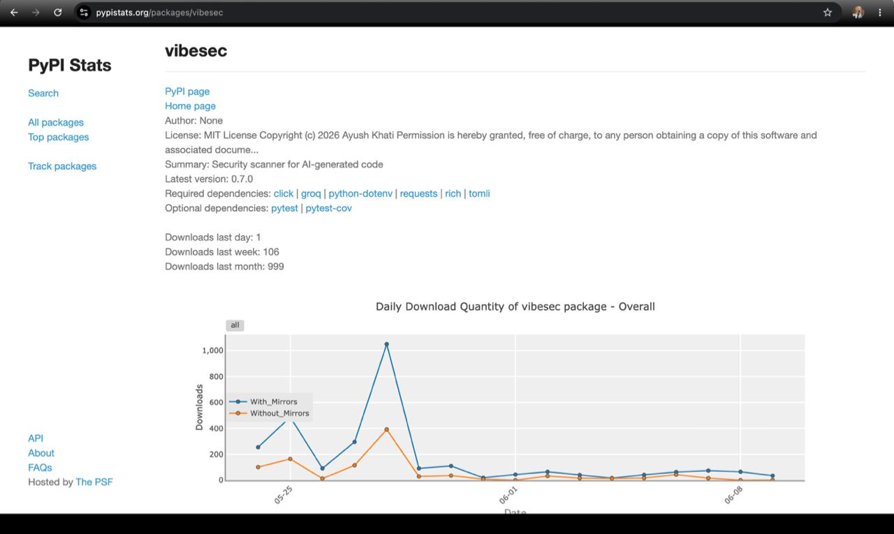

# VibeSec

**Find security bugs in AI-generated code before they ship.**

[](https://pypi.org/project/vibesec/)
[](https://pepy.tech/project/vibesec)
[](https://www.python.org/downloads/)
[](https://github.com/AyushkhatiDev/vibesec/actions)
[](#security-coverage)
[](LICENSE)

AI coding tools can build a working app in minutes. They can also quietly introduce hardcoded secrets, disabled authorization, unsafe JWT handling, command injection, SSRF, insecure Dockerfiles, and risky GitHub Actions workflows.

**VibeSec is a fast CLI security scanner built specifically for that new workflow: AI-assisted, rapidly scaffolded software.**

```bash
pip install vibesec
vibesec scan ./my-app
```

VibeSec gives developers an immediate, practical answer:

- What is vulnerable?
- Where is the risky code?
- How severe is it?
- How do I fix it?

---

## Why VibeSec?

| Problem in AI-generated code | What VibeSec does |
|---|---|
| AI tools copy insecure tutorial patterns | Detects hardcoded secrets, disabled RLS, weak Flask config, unsafe JWTs, and missing auth |
| Generic scanners can be noisy or miss AI-specific mistakes | Ships focused rules for AI-code failure modes like hallucinated packages and scaffolded admin routes |
| Security reviews slow down fast prototyping | Runs as a local CLI, in CI, or against a public GitHub repo |
| Findings are hard to act on | Groups findings by file, assigns severity, gives fix hints, and calculates a risk score |
| Teams need audit-friendly output | Exports terminal, JSON, SARIF, and self-contained HTML reports |

**Current signal:** `24` security rules, `179` automated tests, `999` PyPI downloads, and SARIF support for GitHub code scanning.

---

## 30-Second Demo

```text
$ vibesec scan ./my-app

VibeSec v0.7.0 - AI-Generated Code Security Scanner

CRITICAL   6 findings
HIGH       3 findings
MEDIUM     2 findings

Risk score       79
Files scanned    4
Rules checked    24

config.py
  CRITICAL - Hardcoded Secret
  Found: Database URL with credentials detected in source code
  Fix:   Move to environment variables. Never commit secrets to git.
```

### Real Scan Output

VibeSec is designed to be useful on real projects, not just synthetic examples. The terminal report highlights severity distribution, risk score, files scanned, rules checked, the most vulnerable file, and grouped findings with fix guidance.

<p align="center">
  
</p>

<details>
<summary>View scan summary output</summary>

<p align="center">
  
</p>

</details>

## Current Release

**Latest version:** `0.7.0`

Highlights from the current release:

- 24 registered vulnerability rules
- 179 automated tests
- Parallel file scanning with `ThreadPoolExecutor`
- Rich terminal progress and grouped findings
- Risk scoring: `CRITICAL x 10 + HIGH x 5 + MEDIUM x 2 + LOW x 1`
- SARIF output for GitHub code scanning
- Self-contained HTML reports
- GitHub repository URL scanning with size validation
- Symlink protection and path containment checks
- 10 MB max file size guard
- Binary-file detection using magic bytes
- `.vibesecignore` and `vibesec.toml` configuration
- Batched and cached npm registry checks
- Python taint analysis for SQL, command injection, path traversal, and SSRF sinks
- Basic JavaScript taint tracking fallback for request-data flows
- **Enforcement hooks for Claude Code and Cursor** — block insecure code at write time

---

## Enforcement Hooks

VibeSec has two complementary integration modes for AI coding agents:

| Mode | How it works | When it fires |
|---|---|---|
| **Advisory (MCP)** | Agent calls `check_code()` during its reasoning | Only when the agent chooses to call it |
| **Enforcement (Hooks)** | Runs automatically after every file write/edit | Always — cannot be skipped |

The MCP server is opt-in and cross-client. Enforcement hooks are always-on — they fire after every write and surface security issues that the agent must address.

### Quick Setup

```bash
# Auto-detect Claude Code / Cursor and install hooks
vibesec hooks install

# Or specify the client explicitly
vibesec hooks install --client claude-code
vibesec hooks install --client cursor
vibesec hooks install --client all
```

### Claude Code

VibeSec installs two hooks in `.claude/settings.json`:

1. **`PostToolUse`** — fires after each `Write`/`Edit`/`MultiEdit` call. The file is already on disk, so VibeSec scans it and sends findings to Claude via stderr. Claude sees the error and self-corrects on the next turn.
2. **`PostToolBatch`** — fires after all parallel tool calls resolve. If VibeSec found blocking issues in any file during the batch, exit code 2 **stops the agentic loop** before Claude's next model call, forcing it to address the issues.

```json
{
  "hooks": {
    "PostToolUse": [
      {
        "matcher": "Write|Edit|MultiEdit",
        "hooks": [
          {
            "type": "command",
            "command": "python3 -m vibesec.hook_runner",
            "timeout": 30
          }
        ]
      }
    ],
    "PostToolBatch": [
      {
        "hooks": [
          {
            "type": "command",
            "command": "python3 -m vibesec.hook_runner --batch",
            "timeout": 30
          }
        ]
      }
    ]
  }
}
```

When VibeSec finds CRITICAL or HIGH issues, the `PostToolUse` hook sends the findings to Claude via stderr — Claude reads them and knows what to fix. The `PostToolBatch` hook then stops the loop so Claude addresses the issues before moving on to other work.

### Cursor

VibeSec installs an `afterFileEdit` hook in `.cursor/hooks.json`:

```json
{
  "version": 1,
  "hooks": {
    "afterFileEdit": [
      {
        "command": "python3 -m vibesec.hook_runner"
      }
    ]
  }
}
```

### Hook Configuration

Control enforcement behavior in `vibesec.toml`:

```toml
[vibesec.hooks]
block_on = ["CRITICAL", "HIGH"]   # severities that trigger blocking (exit code 2)
timeout = 30                       # max seconds per hook run
enabled = true                     # kill switch to disable hooks
```

### Hook Management

```bash
# Install Git pre-commit hook (scans staged files automatically)
vibesec hooks install --client git

# Check which hooks are installed
vibesec hooks status

# Remove all VibeSec hooks
vibesec hooks uninstall

# Remove hooks for a specific client
vibesec hooks uninstall --client claude-code
```

---

## Installation

```bash
pip install vibesec
```

For local development:

```bash
git clone https://github.com/AyushkhatiDev/vibesec
cd vibesec
python -m venv venv
source venv/bin/activate
pip install -e ".[dev]"
pytest tests/ -v
```

---

## Usage

Scan a local project:

```bash
vibesec scan ./my-project
```

Scan and block CI/CD pipeline if critical or high issues are found:

```bash
vibesec scan ./my-project --fail-on high
```

Scan a public GitHub repository:

```bash
vibesec scan https://github.com/owner/repo
```

Filter by severity:

```bash
vibesec scan ./my-project --severity critical
```

Ignore specific rules:

```bash
vibesec scan ./my-project --ignore rls,cors,packages
```

Generate AI-powered remediation suggestions with Groq:

```bash
export GROQ_API_KEY="..."
vibesec scan ./my-project --fix
```

Print JSON:

```bash
vibesec scan ./my-project --output json
```

Write SARIF:

```bash
vibesec scan ./my-project --output sarif --sarif-output vibesec-results.sarif
```

Write a self-contained HTML report:

```bash
vibesec scan ./my-project --output html --html-output report.html
```

Check the installed version:

```bash
vibesec --version
```

---

## Security Coverage

VibeSec currently ships with **24 security rules**.

### Core AI-Code Rules

| Rule | Severity | What it catches |
|---|---:|---|
| Hardcoded Secret | CRITICAL | API keys, passwords, tokens, service keys, and database URLs in source |
| Supabase RLS Disabled | CRITICAL | Explicit `DISABLE ROW LEVEL SECURITY` statements |
| SQL Injection Risk | CRITICAL | Tainted Python request data reaching SQL sinks |
| Missing Route Authentication | HIGH | Sensitive/admin routes without visible auth middleware |
| Hallucinated Package | HIGH | Known nonexistent npm package names and suspicious registry misses |
| Source Map Exposure | HIGH | Production source map exposure and committed `.map` files |
| Unsafe JWT Handling | HIGH | `none` algorithm, disabled verification, browser storage tokens |
| Client-Side Role Trust | HIGH | Admin/role checks based on localStorage or URL parameters |
| Insecure Flask Configuration | HIGH | `DEBUG=True`, hardcoded `SECRET_KEY`, weak fallback secrets |
| Credentials in Environment File | HIGH | Real credentials committed in `.env` files |
| Unsafe HTML Injection | MEDIUM | `dangerouslySetInnerHTML`, dynamic `innerHTML`, `eval` |
| Missing Webhook Verification | MEDIUM | Stripe/GitHub webhooks without signature checks |
| Permissive CORS Configuration | MEDIUM | Wildcard CORS and credential misconfigurations |

### Deeper Application Security Rules

| Rule | Severity | What it catches |
|---|---:|---|
| Command Injection | CRITICAL | Dynamic `os.system`, `eval`, `exec`, subprocess shell usage, Node `child_process` sinks |
| Path Traversal | HIGH | User-controlled paths flowing into `open`, `send_file`, `Path`, `fs.readFile`, `res.sendFile` |
| Server-Side Request Forgery | HIGH | User-controlled URLs reaching `requests`, `httpx`, `urllib`, `fetch`, `axios` |
| Insecure Deserialization | CRITICAL/HIGH | `pickle`, `marshal`, unsafe `yaml.load`, `shelve.open` |
| Server-Side Template Injection | CRITICAL | Dynamic `render_template_string`, Jinja/Mako template construction |
| Weak Cryptography | HIGH/MEDIUM/LOW | MD5/SHA1, weak ciphers, insecure randomness for tokens |
| Open Redirect | MEDIUM | Request-controlled redirect destinations |

### Platform and Supply Chain Rules

| Rule | Severity | What it catches |
|---|---:|---|
| Node.js Security Misconfiguration | MEDIUM | Missing Helmet, insecure cookies, prototype pollution patterns, missing rate limiting |
| Next.js Security Issue | HIGH/MEDIUM | Unauthenticated API routes, weak server actions, public secret env vars, missing headers |
| Docker Security Issue | HIGH/MEDIUM | Root containers, secret ENV/ARG, `latest` tags, `curl | bash`, exposed DB ports |
| GitHub Actions Security Issue | HIGH/MEDIUM | Unpinned actions, `pull_request_target` risks, secret logging, shell injection |

---

## Taint Analysis

VibeSec includes an intraprocedural Python taint engine. It tracks user-controlled input through assignments, string formatting, f-strings, comprehensions, ternaries, walrus expressions, and common transformations.

Sources include:

- Flask request data: `request.args`, `request.form`, `request.json`, cookies, headers, files
- Django request data: `request.GET`, `request.POST`, `request.FILES`, `request.COOKIES`
- FastAPI helpers: `Query`, `Path`, `Body`, `Header`, `Cookie`
- CLI and environment sources: `input`, `sys.argv`, `os.getenv`
- WebSocket receive calls

Sinks include:

- SQL execution: `cursor.execute`, `db.execute`, `session.execute`, SQLAlchemy `text`
- Command execution: `os.system`, `subprocess.run`, `os.popen`, `eval`, `exec`
- Filesystem paths: `open`, `pathlib.Path`, `send_file`, `os.path.join`
- SSRF targets: `requests`, `urllib`, `httpx`, `fetch`, `axios`

Example:

```python
user_id = request.args.get("id")
query = f"SELECT * FROM users WHERE id = {user_id}"
cursor.execute(query)
```

VibeSec flags this because request-controlled data reaches a SQL sink.

```python
cursor.execute("SELECT * FROM users WHERE id = %s", (user_id,))
```

VibeSec ignores this because it is parameterized.

---

## Configuration

VibeSec supports both `.vibesecignore` and `vibesec.toml`.

Example `vibesec.toml`:

```toml
[vibesec]
ignore = ["rls", "cors"]
severity_threshold = "medium"
max_file_size = 10485760
exclude_paths = ["tests/", "node_modules/", "dist/"]
exclude_rules = ["packages"]

[vibesec.rules]
secrets.skip_test_files = true
flask_secrets.skip_test_files = true
```

CLI flags override config values where applicable:

```bash
vibesec scan . --ignore rls --severity high
```

---

## Reporting

### Terminal

The default terminal report groups findings by file and includes:

- Severity counts
- Risk score
- Files scanned
- Scan duration
- Total rules checked
- Most vulnerable file
- Fix hints for each finding

### JSON

```bash
vibesec scan . --output json
```

### SARIF

```bash
vibesec scan . --output sarif --sarif-output vibesec-results.sarif
```

SARIF can be uploaded to GitHub code scanning so findings appear in the Security tab and pull request annotations.

### HTML

```bash
vibesec scan . --output html --html-output report.html
```

The HTML report is self-contained and includes a summary table, findings grouped by file, and code snippets.

---

## GitHub Actions

```yaml
name: VibeSec

on:
  push:
  pull_request:

permissions:
  contents: read
  security-events: write

jobs:
  scan:
    runs-on: ubuntu-latest
    steps:
      - uses: actions/checkout@v4
      - uses: actions/setup-python@v5
        with:
          python-version: "3.11"
      - name: Install VibeSec
        run: pip install vibesec
      - name: Run scan
        run: vibesec scan . --output sarif --sarif-output vibesec-results.sarif
        continue-on-error: true
      - name: Upload SARIF
        uses: github/codeql-action/upload-sarif@v4
        if: always()
        with:
          sarif_file: vibesec-results.sarif
          category: vibesec
```

---

## MCP Server (AI Agent Integration)

VibeSec ships an MCP server that AI coding agents (Claude Code, Cursor, Windsurf) can call mid-task. Install as an optional extra:

```bash
pip install "vibesec[mcp]"
```

Agent-side config (e.g. `.claude/mcp.json`):

```json
{
  "mcpServers": {
    "vibesec": {
      "command": "python3",
      "args": ["-m", "vibesec.mcp_server"]
    }
  }
}
```

### MCP Tools

| Tool | What it does |
|---|---|
| `check_code(code, filename)` | Scan a code snippet — returns issues with severity, line, fix hint |
| `check_file(file_path)` | Scan a file on disk |
| `check_diff(diff, filename)` | Scan only added lines from a unified diff |
| `suggest_fix(code, issue, filename)` | **Generate an applicable unified diff** for a specific issue |
| `list_rules()` | List all 24 security rules |

### suggest_fix — LLM-Powered Code Fixes

`suggest_fix()` goes beyond static advice. It generates a real unified diff using rule-specific knowledge about *how* AI coding tools introduce each vulnerability and *exactly* how to fix it:

```
Agent workflow:
  1. result = check_code(code, "app.py")     → finds SQL injection on line 5
  2. fix = suggest_fix(code, result.issues[0]) → returns a unified diff
  3. Agent applies the diff
  4. check_code(fixed_code, "app.py")          → clean=true ✓
```

Each of VibeSec's 24 rules has a specialized fix template encoding:
- How AI tools typically introduce this specific bug
- The canonical fix pattern (not generic advice)
- Known pitfalls in the fix itself (e.g., "don't use `.format()` to fix SQL injection — it's equally injectable")

Requires `GROQ_API_KEY` for LLM-generated diffs. Without it, returns static `fix_hint` text as a fallback.

```bash
export GROQ_API_KEY="..."
```

---

## Engineering Notes


VibeSec is intentionally lightweight:

- Rules are plain Python functions with a stable finding schema.
- Python checks use AST analysis where precision matters.
- JavaScript/TypeScript analysis uses a Node parser when available and falls back to regex/taint heuristics.
- File walking is cached and avoids symlinks, oversized files, binary files, build directories, and dependency directories.
- npm registry checks are batched, cached, timeout-bound, and capped to avoid slow scans.
- GitHub repository scans validate `owner/repo`, check repository size through the GitHub API, and reject repositories larger than 500 MB.

Finding schema:

```python
{
    "rule": "Rule Name",
    "severity": "CRITICAL|HIGH|MEDIUM|LOW",
    "file": file_path,
    "line": line_number,
    "message": "What was found",
    "fix_hint": "How to fix it",
    "code_snippet": "offending code",
}
```

---

## Testing

```bash
pytest tests/ -v
```

Current test coverage:

- 179 passing tests
- Positive and negative tests for every new v0.7.0 rule
- CLI tests for `--ignore`, `--version`, and missing paths
- Scanner tests for parallel scanning
- Reporter tests for HTML output
- Utils tests for symlink protection, binary detection, file size limits, and GitHub URL validation

---

## Roadmap

Completed:

- [x] 24 security rules across app, platform, supply-chain, and CI/CD risks
- [x] AST-backed Python taint analysis
- [x] Basic JavaScript taint analysis fallback
- [x] SARIF, JSON, terminal, and HTML reporting
- [x] GitHub URL scanning
- [x] Config file support
- [x] Parallel scanning
- [x] Symlink, path containment, binary-file, and file-size protections
- [x] CI test pipeline

Next:

- [ ] Systems-language file discovery for C, C++, Rust, and Zig
- [ ] C/C++ security rules for unsafe libc calls and memory-management patterns
- [ ] Rust rules for `unsafe`, raw pointers, FFI, manual `Send`/`Sync`, and crash-prone `unwrap`/`expect`
- [ ] Zig rules for allocator misuse, integer overflow-prone operations, and `unreachable`
- [ ] Parser-backed systems-language research using tree-sitter, clang, rust-analyzer, or Zig compiler APIs
- [ ] VS Code extension
- [ ] Web dashboard for hosted scans

---

## Project Vision

VibeSec is not trying to replace every security scanner. It is focused on a specific and growing problem: **AI-assisted development creates working software faster than teams can review it safely.**

The project aims to be:

- Fast enough to run during local development
- Precise enough to avoid noisy reports
- Practical enough to explain how to fix each issue
- CI-friendly through SARIF and JSON
- Extensible through simple Python rule modules

---

## Author

Built by [Ayush Khati](https://github.com/AyushkhatiDev).

VibeSec started as a focused scanner for AI-generated web-app vulnerabilities and has grown into a broader static-analysis project covering application security, deployment security, supply-chain risk, and CI/CD misconfigurations.

If you find a bug or want a new rule, open an issue:

https://github.com/AyushkhatiDev/vibesec/issues

---

## License

MIT. See [LICENSE](LICENSE).
